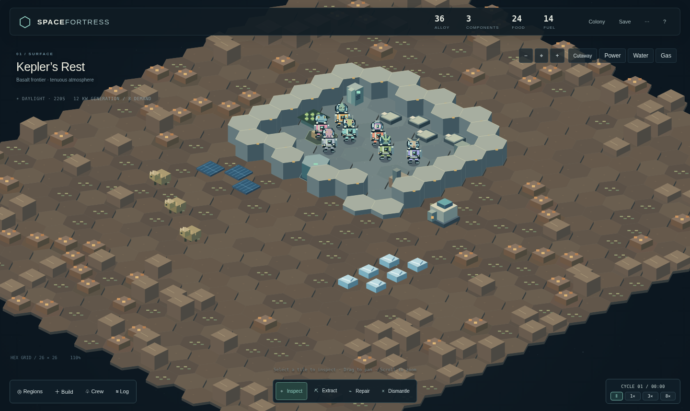

# SPACEFORTRESS

An early playable space colony simulator inspired by Dwarf Fortress. Keep seven alien founders alive, build a planetary colony, and send supplied expeditions into orbit to recover material for its next expansion.

**[Play online](https://jaredcastorena.github.io/spacefortress/)** · [Online elements lab](https://jaredcastorena.github.io/spacefortress/elements.html) · [Release v0.1.9](https://github.com/Jaredcastorena/spacefortress/releases/tag/v0.1.9) · [Roadmap](ROADMAP.md)



**The game is still in development.** Build across connected floors using paid stairs, supported upper-floor extensions and a compact floor selector. Orbital destinations remain fixed. Long-lived staffed outposts, complete vertical systems, a generated universe/history and much of the wider simulation remain unfinished. The [implementation status](docs/implementation-status.md) separates working systems from plans.

## Agent entry briefing

Start with [CASTOR.md](CASTOR.md) for the current architecture, version boundaries and focused entry points. The [file map](docs/FILE_MAP.md) provides per-file navigation; the [version ledger](docs/AGENT_VERSIONS.md) preserves release and compatibility distinctions.

## Local development after v0.1.9: floor-specific exposure

Crew fire injuries now follow the tile they occupy. Wreck-debris shelter uses the current floor, and a docked shuttle protects only occupants at its actual terminal position. Fire and debris exposure events identify the affected floor. Five new synthetic boundary cases cover stacked occupants, shelter, terminal protection and exact save continuation; ordinary upstairs endurance remains unfinished.

## v0.1.9: manufactured mining tools

Build a tool workshop on a supplied habitat floor. Alloy tools consume two alloy and one component; composite tools use two of each and need a production operator at skill level three. Materials and operator skill affect mining speed, and tools wear only while doing actual mining work. Broken tools leave hand mining available.

Select a crew member and open **Choose a mining tool** to request a physical pickup. The crew member walks to the tool; it retains its identity through hauling, equipment, release and repair. Put down a worn tool and select the workshop’s repair recipe to restore it using one delivered alloy. Tools and personal keepsakes occupy separate slots. Save schema64 preserves earlier valid hex saves and adds tool custody and pending pickups. Existing depot filters are preserved: enable Tools in a depot’s accepted resources to receive the new items.

## v0.1.9: stair fire containment

Open or damaged stair hatches now let a mature fire ignite a combustible fitting immediately beside the opposite landing. Both directions use the existing oxygen, wetness and fuel checks. Intact closed hatches and solid ceilings contain this spread; sealed utility risers do not carry flames. A source still creates at most one new fire per thirty-tick spread interval, with horizontal spread taking priority. New fires begin burning on the following tick. The ignition event names the parent fire and stair connection. Focused checks cover containment, physical combustion, save continuation and existing suppression orders; ordinary upstairs endurance remains unfinished.

Personal belongings also stay on the owner’s actual floor when put down or dropped after death. Item and prepared-meal observations distinguish stacked floors, preserving their identities through stair pickup and hauling.

## v0.1.8: recoverable impact material

Debris impacts now bring three ore units to the floor they hit. A reserve holds at most twelve units; overflow or a collision with an ice reserve leaves loose ore without replacing the ice. Empty space retains none. Mining transfers a finite batch into a pile on that floor and preserves the structure underneath. Crew can haul it through existing stairs to a depot and refinery.

A shared extraction module handles ice, impact ore, natural rock/ore and salvage. The normal mining command accepts a floor, stale orders cancel when their source disappears, and covered natural terrain cannot be mined through a structure. Incoming ore pauses affected construction without consuming its staged supplies; cancel or resolve the work before resuming. Inspection and structured observations show source, yield and required work, while arrival/extraction/depletion events identify the actual floor and physical output.

Release v0.1.8 uses save schema63 and preserves genuine schema62 mining and construction state. Constructed upper grids still begin empty. Upper natural-geology cases use explicit test conditions; recoverable impacts are available in normal play. Ordinary upstairs endurance remains unverified.

## v0.1.8: upstairs gardening

Build a planter bed on a constructed floor for two alloy and one fertilizer. Production workers carry matching raw fungalcap or sunberry food to plant it, deliver water in half-unit doses, and gather mature crops on the actual floor. Stair routes, food age, reservations, cancellation and output hauling use the existing physical systems. Planters retain finite moisture and can absorb available floor water; a destroyed or dismantled bed returns its retained water at that location. Sunberries now share the solar system's overhead-obstruction check, while fungalcap keeps its existing temperature and darkness tolerance.

The collapsed plant controls use actual-floor supplies, routes and job ownership. The canvas renderer shows the bed and its growing crop. Release v0.1.8 includes the schema62 cultivation migration in its schema63 saves, preserving genuine schema61 gathering without resetting physical state. Focused checks separate native paid work from synthetic crop maturity/ecology conditions. Ordinary upstairs endurance remains unverified.

## v0.1.7: upper-floor airlocks and hazard response

Airlock controllers can now be built through normal paid jobs on declared upper floors. The six airlock commands accept optional z; their X/Y equipment references use the controller’s floor. Ownership, queue/cycle state, rescue parties, cargo, movement, event IDs and inspection retain that floor. Approaches can use declared stairs. Each assembly remains on one floor, with two controlled doors and a finite isolated gas circuit. An exposed upper walkway must have low measured pressure before outer release. A stair opening in the chamber or a gas riser attached to its owned circuit invalidates the enclosure, including a disabled riser that could later open. Power risers remain independent. Upper-floor airlocks do not establish ordinary upstairs endurance. Version 0.1.7 uses save schema61 and migrates validated hex schemas40–60.

Engineers can now suppress fires upstairs using two physically delivered water. Automatic repair and servicing also target the correct floor and consume one delivered alloy. Existing stair routes, labor duties, material reservations and cancellation rules apply. Fire details and incident messages identify the floor, and structured events retain the same ownership.

## v0.1.6: upstairs livestock and sunlight

Livestock can now use stairs and upper-floor posts, including supplied feeding, veterinary care, product collection and carcass work. Pastures follow usable stair connections, and births can use clear constructed floors. Stair removal protects upstairs animals as well as crew.

Solar arrays now need daylight and a clear vertical column above them. Higher terrain and intact structures block generation; empty space and bare utility overlays do not. The inspector identifies the blocking floor, and structured observations expose the same reason. Batteries still supply only their stored energy. Save schema59 validates older power accounting before recalculating sunlight availability, preserving physical resources, battery charge and the energy ledger. Validated hex schemas40–58 migrate to the current format.

In published v0.1.6, upper-floor airlocks and the complete upstairs build-and-live journey remained unfinished. Version 0.1.7 adds upper airlocks and hazard response. Focused checks pass; the [release record](https://github.com/Jaredcastorena/spacefortress/releases/tag/v0.1.6) records release CI and deployment verification.

## v0.1.5: connected floors and utility systems

Build paid stairs to expand upward, select installed floors with the floor menu or Page Up / Page Down, and carry supplies between them. Stair hatches, damage, repairs and safe removal use shared simulation rules.

Power, gas and water risers now connect matching cables or pipes on adjacent floors. Build both endpoints first, then place the riser on the lower floor: each costs two alloy and eight work. Select either endpoint to isolate the connection, repair it for one alloy, or dismantle it and recover one alloy. Gas and water remain finite; closing a stair hatch does not isolate a riser.

Version 0.1.5 also included accumulated crew-care, inventory, food, suit-supply and airlock recovery fixes. Animal traversal and solar occlusion were added in v0.1.6; upper-floor airlocks and hazard response were added in v0.1.7. The complete upstairs build-and-live journey remains unfinished. See the [roadmap](ROADMAP.md).

## Additional systems fixes in v0.1.5

An [offline waste-containment helper](tools/contain-habitat-waste.mjs) now reproduces normal freight pickup with finite limits and explicit partial results. Its seven focused checks pass; see [usage and limits](docs/sanitation.md#offline-containment-helper).

Ordinary hauling now exposes exact resource transfers in local recordings, including partial deliveries and cargo setdowns. Stable carrier and inventory addresses make these interactions inspectable by future local agents; recording preserves the same simulation results. See the [simulation interface](docs/simulation-interface.md).

Crew can now deliberately release suit oxygen into the sealed room they occupy, through a collapsed **Emergency oxygen** control. The shared player/agent action spends a finite personal reserve, checks room capacity and records who transferred the gas. It can make air oxygen-rich, so the control explains that risk.

Crew seeking air can now walk to local packaged mix when no breathable compartment is reachable, with finite suit refill and explicit supply records. Structured crew observations now report every personal work blocker through the same rules used by job assignment. Workstations distinguish qualified operators from those personally ready for work, with explicit reasons when nobody can start. This exposes fatigue, recovery intentions, low suit air and other constraints for local controllers. Focused suit-recovery checks and combined integration verification are recorded in the verification status. Destroyed biofilter traps now stop using bait and capturing pests until repaired. Capture records include the quarter-food cost. Opened meals now keep the freshness of their remaining food, including after interruptions and save/reload. Production targets also count goods already unloaded at a dock, so supplied outposts avoid unnecessary batches. See the [changelog](CHANGELOG.md) and [verification status](docs/verification-status.md) for details. These results were recorded before v0.1.5.

Use the floor chip beside the site name, or Page Up / Page Down, to view installed floors. Build a stairwell on a clear habitat floor to reach the next floor; upstairs floor extensions need support directly below. Select either stair landing to control its hatch, repair it, or dismantle and seal it. Repairs cost1 alloy; dismantling costs1 alloy and returns3. Removal leaves both floors and requires clear landings and a remaining route for any crew upstairs. Switching views does not pause offscreen work.

## Latest local evidence: paid supplies and recovery limits

The paid airlock colony has now loaded and unloaded one alloy through ordinary freight work. Its return trial stopped when stored habitat waste caused minor crew injuries. A normal freight pickup subsequently contained all 3.5 waste, removing exposure at tick 1712; the waste and alloy remain physically carried. The return, medical recovery and sustained operation remain unfinished. See the [verification record](docs/verification-status.md) for the preserved failure and bounded containment.

An ordinary orbital salvage trip returned **three components to colony storage**. A continuation then paid for an ice processor, mined **24 ice**, produced **24 water**, and converted **20 water into 200 air**. These runs use the same public controls and physical jobs as player commands.

The second run reached its 800-tick limit with **10.5 water remaining**, but full air recovery failed. Debris had damaged a habitat wall, leaving a leak; tibbles consumed all 13 stored rations. A subsequent paid repair restored the damaged wall to full condition at tick 1942, using one alloy and 15 ticks with everyone healthy.

A further 180-tick run built a paid trap and captured all eight tibbles, including one newborn. Its four harvested food portions were consumed by bait and pest feeding, leaving no food reserve at tick 2122.

A subsequent ordinary livestock collection delivered two curd portions into storage at tick 2167 after 45 ticks, with the original collection policy restored and everyone healthy. Ongoing food supply and full air/suit recovery remain unfinished. See the [verification record](docs/verification-status.md) for evidence and limits. These results were recorded before v0.1.5.

Recovered gas now stays usable across airlock cycles: refill opens the disabled extractor’s passive store, while extraction remains off. A [finite-pocket regression](tests/airlock-core.test.js) verifies actual gas transfers and closed idle valves. Sixty affected core, integration, hex and commissioning checks pass. The ordinary cargo return and overnight conditioning remain unfinished.

Airlocks also correct release pressure drift caused by normal suit refilling: with everyone inside and both doorways clear, the controller reseals and rematches pressure using finite stored gas. Sixty-four affected checks pass. Two [synthetic cargo scenarios](tests/airlock-freight-integration.test.js) now return the same alloy parcel through outward and inward crossings, with all seven crew healthy and settings restored. The tighter reserve case uses a finite suit oxygen release and a real air delivery. These scenarios establish mechanics; the ordinary colony journey and sustained operation remain unverified.

A bound airlock can now use a gas supply tank instead of a passive reservoir. Crew deliver breathing mix normally, and loading reserves space for recovered chamber gas. A request waiting for empty supply can replenish before the normal admission checks run again. In the [finite loading scenario](tests/airlock-core.test.js), 20 air units load and the request is admitted at tick 58, with all seven crew uninjured. Ninety-nine affected checks pass across focused and distinct integration runs. An additional [fixed-resource repeat check](tests/airlock-freight-integration.test.js) now completes two cargo roundtrips after four air units are natively delivered to the exterior tank: 220 ticks, seven healthy crew home and battery charge 119, with original settings restored. This reaches the first night tick; full-night operation, ongoing production/resupply and ordinary paid installation remain ahead.

A separate paid airlock colony now has a verified finite recovery from tick 1292 to 1372. The [offline helper](tools/paid-air-recovery.mjs) used two water to make 20 air and returned all seven crew home uninjured, with safe habitat and chamber air, ten reachable air and a full battery. Its 14 focused checks pass. The same colony subsequently commissioned its airlock at tick 1400 through the [bounded helper](tools/paid-airlock-commissioning.mjs): 28 ticks and 53 successful actions, with ten air still reachable and the battery at 120. The named cargo journey and sustained habitation remain unfinished.

## Earlier local evidence: finite room and suit reserves

Using the unchanged published v0.1.4 runtime, one reviewed continuation ran **460→951: 491 ticks and four commands**. Twenty-four paid batches, including the previously committed batch, turned 24 water into 240 air. The habitat passed every end-of-tick breathing check through both nights. All seven suits reached 100%; all seven crew and five animals stayed fully healthy.

The endpoint had 100% nominal pressure and **18.003% oxygen at that pressure**, but only **10.5 water and no packaged air** remained. This establishes a finite room/suit reserve under those conditions, not sustained exterior work or an ongoing supply chain. Water replenishment, paid airlock commissioning and the complete ordinary livestock-to-meal journey remain ahead. See [air recovery guidance](docs/atmosphere.md#player-guidance-recovering-finite-air) and the [verification record](docs/verification-status.md). No runtime or version change accompanies this local evidence.

## v0.1.4: clearer air warnings and bounded recovery

**Version 0.1.4 keeps save schema 46 and the existing gas rules.** The atmosphere inspector now distinguishes oxygen concentration from **Oxygen at this pressure**, shows the safe 16–30% nominal range and explains the same first failed limit used by crew and local-agent observations. The original unsafe room contained 20.736% oxygen, but its lower pressure left only 15.8476% of nominal oxygen available. Importing a save now preserves the actual prior speed, including pause, on completion, failure or cancellation.

One full local run passed **1,282 checks, zero failures and one intentional skip**. Seven affected panel checks then passed after a presentation-only change that made the warning span the inspector width. Browser review confirmed that importing the original tick-144 save while paused kept its clock still and showed the shared low-oxygen explanation clearly.

A separate paid recovery first stopped at its tick-384 budget after producing ten air without reaching breathable conditions. A reviewed continuation then ran 384→460: 76 ticks and three commands, producing **40 air from four water** and keeping home breathable for 12 consecutive ticks. All seven crew and five animals stayed fully healthy; three checkpoints reopened exactly. The processor was paused with its next paid batch preserved.

At the earlier tick-460 stop, the room held **exactly the minimum 56 oxygen units**, with suit reserves only 76.79–78.49%. This proves bounded recovery, not a durable reserve or sustained exterior work. The original tick-144 livestock stop and tick-384 recovery stop remain recorded; the full ordinary livestock/kitchen chain is still unverified. See [atmosphere](docs/atmosphere.md) and [verification status](docs/verification-status.md). The [v0.1.4 release record](https://github.com/Jaredcastorena/spacefortress/releases/tag/v0.1.4) tracks the final commit, required CI/Pages results and hosted checks; local evidence here does not establish deployment success.

## Published v0.1.3: hex colonies and deeper food chains

The release build uses **six-sided hex tiles** for terrain, construction, movement, sealed rooms and utility connections, with the isometric view retained. Directional devices face one of six neighbors. Experimental [pressure-cycling airlocks](docs/airlock-cycling-design.md) recover and refill actual gas while crew retain their work and cargo.

Version 0.1.3 includes three crops, two productive livestock species and ten recipes with ingredient and skill requirements. Livestock now inherit individual temperature preferences and production pace: faster products require faster feed use, while cold tolerance trades against heat tolerance. A carried brood saves the offspring's inherited traits at conception. See [animal traits](docs/animal-traits.md) and [breeding](docs/breeding.md).

Wild fungal caps and sunberries grow through visible stages and can be gathered by crew; lichen supports grazing. Crew can also plant matching raw food as ground beds, deliver finite water and harvest their regrowth. See [cultivation](docs/cultivation.md) for costs and growing conditions. Persistent fire and temperature injuries use delivered medicine and gradual recovery at a post. Food identity, age, maker and quality survive physical hauling and cooking. See [flora, livestock and cooking](docs/food-and-ecology.md) for combinations and progression, and [veterinary care](docs/veterinary-care.md) for treatment.

Livestock deaths now leave physical bodies that handlers can carry to a husbandry post for butchery. Tame adults can be ordered for slaughter; fresh bristleback and glazefoot meat combine with fungal caps or sunberries in two new meals. Body age continues through carrying and processing, and spoiled bodies require disposal. See [butchery](docs/butchery.md) for fixed yields, work and restrictions.

Local verification covers **1,264 distinct passing checks and one intentional historical skip**. The first full run passed 1,263 checks and found one stale recipe-option expectation; its exact repaired check then passed, without repeating the full suite. Focused food, body, interface and integration checks cover 8, 49, 9 and 77 cases. Actual schema-45 saves preserve their prior state through migration, with six exact current reloads.

The ordinary livestock trial stopped at tick 144 after 78 additional ticks and three commands because home air was no longer breathable. Two paid posts finished at tick 85 and two care deliveries raised the target's trust to 80. All seven crew and five animals stayed healthy; no slaughter, body, meat or new meal occurred. The complete ordinary chain remains unverified. Habitat and exterior-work air reserves are the next priority.

Local browser review passed fresh save/reopen, actual save import, ten recipe choices, applying and preserving Bristlecap braise selection, and a readable 390-pixel layout. It did not cover corpse handling or a cooked meat meal. See [release readiness](docs/release-readiness.md) for local scopes and the [v0.1.3 release record](https://github.com/Jaredcastorena/spacefortress/releases/tag/v0.1.3) for hosted verification. Earlier results below describe their own increments.

The preceding trait build passed **1,210 regression checks, zero failures and one intentional skip** on its first full run. Actual previous-build migration preserves physical state and reopens exactly; focused checks also cover carried broods, offspring and injuries. One supplied-parent/pasture trial produced a healthy inherited hatchling at tick 301 using three commands, with six exact reloads. Folded founder/brood/offspring details and a 390-pixel layout passed browser review; ordinary herd construction and long-term balance remain unverified. Earlier 26 Python checks apply to unchanged tooling.

The preceding cultivation increment completed a fresh-colony planting→watering→harvest cycle at tick 853 using six commands: one gathered fungal-cap portion and one water produced two cultivated portions. All seven crew and five animals stayed healthy, and 24 checkpoints reopened exactly. Its browser checks covered planting/watering cancellation, growing and mature beds, harvest availability and a narrow layout.

Earlier ordinary play built a galley, gathered native caps and cooked two fungal-stew portions, with everyone healthy and four exact reloads. A preserved colony checkpoint has healthy founders, a repaired scrubber and two restored solar arrays. A separate fresh-colony airlock trial completed paid assembly and sixteen replacement-air batches, returning everyone to safe home air. Debris then damaged the chamber wall. A paid repair restored it, but the crew-return trial exhausted its packaged air and stopped with one engineer still in the chamber; all seven remain uninjured. Commissioning, a parcel roundtrip and long-term food balance remain pending. See the [verification record](docs/verification-status.md) for exact scopes and remaining acceptance work.

An early construction trial exposed air loss during hauling. A continuation delivered all mined ore, sealed the door and restored breathable air; both manufacturers resumed work and all seven crew stayed healthy. A saved continuation met the recovery reserve target. Crew now share breathing air before optional suit charging, with warnings when habitat breathing needs suit reserves. The complete airlock construction journey still needs play testing.

Version 0.1.7 uses save schema61 and migrates validated hex schemas40–60. Schema60 admits upper-floor airlocks; schema61 admits upper suppression and automatic maintenance jobs. Version 0.1.6 used schema59. Version 0.1.5 used schema57; v0.1.4 used schema46. Schema-40/41/42/43/44/45/46/47/48/49/50/51/52/53/54/55/56 hex saves have explicit migrations preserving existing plants, animals, food, health, ancestry and progress. Schema47 adds an explicit landing deck and deck-zero coordinates to tiles, crew, jobs and creatures without changing their existing physical state. Schema48 adds explicit deck-zero shipment sources and pickup/delivery targets while preserving their physical owners and contents. Schema49 extends explicit positions to medical cots, home bunks, crew needs and personal pickup claims. Home ownership stays on the surface while a crew member travels. Schema50 extends positions to animal posts and carcasses on tiles; carried and staged bodies retain their single crew/job owner. Schema51 adds full positions to airlock equipment, chamber cells and traveler reservations without resetting in-progress cycles. Schema52 gives each room an explicit deck while retaining its local cell list. Horizontal gas and heat flow, breathing, equipment heating and room rebuilding distinguish stacked rooms. Schema53 adds deck coordinates to debris forecasts and damage history. Schema54 adds room-purpose anchor decks. Schema55 admits paid stairs and validated multi-floor layouts. Schema57 adds paid utility connections and endpoint ownership, migrating older colonies with empty connection lists and unchanged physical contents. Schema56 adds connection-owned stair repair/removal jobs and preserves upstairs job reservations. Observation/recording schema9 exposes these positions and outpost dock coordinates alongside room decks, and gives pasture regions explicit z and full-position cell lists. Room purpose, occupants, residents, furniture, waste and comfort stay on their actual floor; shelter destinations and outpost readings use full positions. Electrical graphs and breaker branches distinguish stacked decks; ground circuit and tile IDs remain unchanged. Gas pipes, plumbing, pumps, leaks and horizontal floor spills also retain their deck. Fire spread, reactor cooling and debris impacts now resolve the actual deck. Damage history and debris forecasts retain z; unsupported upper-deck fire and service requests report a block instead of issuing work downstairs. Pasture boundaries, mates, birth occupancy, grazing, pest feeding and trap capture/payment use the actual floor. Upper pasture and plant records have distinct IDs; existing ground IDs stay unchanged. Sixteen equipment commands now accept an explicit floor with shared player/agent validation, preserving the existing ground default and device protections. Eleven production, storage, room, housing, maintenance and gate controls also retain the selected floor, including their job/reservation side effects. A 28th action, job.order, now supports supplied basic construction, repair, service and dismantling within an existing declared floor. Workers physically collect and deliver materials on that floor; cancellation retains custody. This is verified in bounded synthetic scenarios. Other work families, animal traversal, upper airlocks, utility risers and solar occlusion remain unfinished. Balanced livestock traits preserve current rates and temperature ranges; later offspring can inherit stronger expressions. Migration grants no plants, animals, medicine or healing and does not invent old wounds or turn old food into named ingredients. Animals already dead in older saves gain an exhausted legacy record, with no new body or meat. Square saves from schemas 1–39 cannot be loaded into this version; their original contents remain protected and exportable. Continue those colonies with the matching square version. The separate gravity-based elements lab keeps its square grid.

## Earlier v0.1.2: freight and wreck settlement

- Physical freight manifests: workers load and unload existing goods, with cancellation, capacity and flight reserves preserved.
- Experimental wreck settlement: delivered local construction, measured habitat readiness, named residence and return-passenger controls.
- Crew work, meals, rest and care use their actual site; compact inspectors expose supplies and offsite warnings.
- An explicit one-person service visit to an established wreck leaves a seat for a resident pickup.
- More reliable departure loading, blocked-carrier parcel recovery and physical shuttle checks; save schema38 preserves older owned supplies and crew.

**Outpost endurance is still experimental.** Bounded real freight and residence controls passed player checks, but a complete fresh-colony settlement, delayed resupply, ordinary remote care and final pickup walkthrough remains unfinished. Plan actual gas, heating and night battery reserves; a room being ready now does not prove it can survive the night.

The v0.1.2 build passed **958 tests with one intentional historical skip**, plus 15 Python checks. See the [verification record](docs/verification-status.md), [changelog](CHANGELOG.md) and [roadmap](ROADMAP.md) for scope and next work.

## Play online

The hosted game and separate elements lab use the links above. The first online load fetches static HTML, scripts and styles from the same GitHub Pages origin, then the simulation runs in your browser. There is no gameplay backend, account requirement or cloud save service. Use the local setup below for offline play.

## Play locally

You need **Python 3** and a recent desktop browser with JavaScript and Canvas support. **Node.js 20 or newer** is needed for optional simulation examples and tests. Linux development currently uses Python 3.12 and Node 20, with scoped Firefox and Chrome browser checks; wider platform/browser coverage is limited.

Clone the public GitHub repository with:

```sh
git clone https://github.com/Jaredcastorena/spacefortress.git
cd spacefortress
```

You can also download and extract the source archive from the repository page. In the project directory, run:

```sh
python3 tools/serve.py
```

On Windows, use `py -3 tools/serve.py` if Python is installed through that launcher. Open **[http://127.0.0.1:8420/](http://127.0.0.1:8420/)**. Keep the terminal open while playing; **Ctrl+C** stops the server. Use the server rather than opening `index.html` directly, because the game loads JavaScript modules.

If port 8420 is already in use:

```sh
python3 tools/serve.py --port 8421
```

Then open `http://127.0.0.1:8421/`. A different port has separate browser save storage; export your colony before moving between addresses.

There is **no build step or package installation**. Python serves the files on your own computer; the simulation runs in the browser. All game code and graphics are included in the checkout. Local play makes no external runtime network calls and needs no account, cloud service, additional asset download or model download. Once you have the source and tools, it runs offline through the local server.

## First session

1. Pause with **Space** and inspect the starting colony. **Colony**, **Crew** and **Log** open details; **Esc** closes menus.
2. Use **Build** to select a structure, then click a valid tile. Crew reserve real supplies, collect them and work at the site. Inspect blocked work for its reason.
3. Use **Extract** on deposits. Keep routes clear, supplies accessible, and life support powered and stocked. Pressure doors, leaks and cold rooms affect the crew.
4. Open **Regions → Relay K-07**, choose two ready crew and prepare an expedition. Workers must load its supplies before the selected pair walks to the shuttle. At the wreck, extract satellite material, let crew carry it to the dock, then recall them.
5. Use returned parts for an advanced solar array or a paid shuttle fitting. See the [colony-to-orbit walkthrough](docs/orbital-colony-loop.md) for the complete loop and its limits.

### Controls

| Input | Action |
| --- | --- |
| Click a tile | Inspect it, or designate the selected work |
| Drag the map / arrow keys | Pan |
| Mouse wheel / − and + | Zoom |
| Home / center button | Center the view |
| Space / time buttons | Pause or select 1×, 3× or 8× speed |
| 1 / 2 / 3 / 4 | Inspect / Extract / Repair / Dismantle |
| Esc | Return to inspection and close drawers |
| Build / Regions / Crew / Colony / Log | Open the corresponding menu |
| Cutaway / Power / Water / Gas | Toggle map views |
| ? | Open the in-game guide |

Keyboard shortcuts are inactive while editing a form or using a dialog. If a button has focus, use the time controls or focus the map before pressing Space.

## What is playable

- **Colony work:** physical material reservations, mining, hauling, construction, staffed production, finite depots, food preservation, farming and recycling.
- **Crew lives:** work duties and skills, hunger, rest, social needs, housing, injuries, medical treatment, carrying patients and bedside care.
- **Environmental systems:** compartment gases, pressure doors, finite gas networks and retained exhaust, room heat, water plumbing and spills, fire/smoke, wired power, batteries, reactors and wet-fault breakers.
- **Orbital expeditions:** explicit two-person crews, physical loading/boarding, limited cargo, satellite salvage, comet resources, solar collection, return trips and supplied fittings.
- **Wreck settlement preview:** physical freight, local building, readiness, residence/return selection and site-local care controls. Full endurance and resupply acceptance is pending.
- **Original setting:** alien crew, bristleback and glazefoot livestock, biomass-eating tibbles and small fictional anomalies, shown on an isometric map with details in drawers.
- **Local simulation interface:** shared player/agent actions, stable entity IDs, structured observations and optional bounded recordings. No model or training service is included.

These are game-scale models with documented gaps, not full Dwarf Fortress parity or realistic engineering simulations. The [conversion inventory](docs/conversion-inventory.md) tracks the broader work. The [staffed outpost design](docs/staffed-orbital-outpost-design.md) describes the implemented preview and remaining gameplay acceptance.

## Saves and recordings

**Save** writes the colony into this browser's local storage under `spacefortress-save-v1`. The game also autosaves every 30 simulation ticks and when the page is hidden or closed. Saves are tied to the browser profile and page origin, including the port; clearing browser data can remove them. Nothing is uploaded to a server or written into the source tree.

Hosted play and local play have different origins and therefore separate saves. To move a colony, use **⋯ → Export save** at the old address, then **⋯ → Import save** at the new address. Saves remain browser-local on GitHub Pages too; they are not synchronized between browsers or devices.

Use **⋯ → Export save** for a portable JSON backup, and **⋯ → Import save** to restore one. Import replaces the current colony after validation; export first if you want to keep both. **New colony** also replaces the current colony and asks for confirmation. If an existing save cannot be read, the game protects it from automatic replacement and offers its original contents for export. When browser storage is unavailable, use export to keep your progress.

Optional **Start recording / Export recording** controls export local NDJSON observations and actions. Recordings are bounded, are separate from save files, and do not change simulation results. See the [simulation interface](docs/simulation-interface.md).

## Elements lab

Use the [online elements lab](https://jaredcastorena.github.io/spacefortress/elements.html), or open **[http://127.0.0.1:8420/elements.html](http://127.0.0.1:8420/elements.html)** after starting the local server, for the separate air/water/fire/vacuum/electricity sandbox. It starts paused; choose a scenario or brush, then **Step** or **Run**. The reactor scenario includes finite fuel, waste heat, radiators and overheat recovery.

The lab has its own state and does not change the colony save. Its cell simulation is separate from the colony's room simulation. [Lab rules and controls](docs/elements-lab.md) explain the differences.

## Local construction example

With Node.js 20 or newer, run a paid construction scenario through the same commands used by local agents:

```sh
node tools/paid-airlock-example.mjs
```

It prints a compact JSON result with material, crew, air and power readings. The recorded check built all 22 planned placements by tick 407 using actual mining, hauling and manufacturing; all seven crew remained uninjured. The example stops at construction. Airlock commissioning, passage and sustained habitation remain unfinished.

To export the resulting colony for the game's save import control:

```sh
node tools/paid-airlock-example.mjs --save colony.json
```

The [callable example](tools/paid-airlock-example.mjs) also supports optional bounded local recording. Its [focused integration check](tests/paid-airlock-example.test.js) verifies delivered construction materials, typed work and recipes, exact save import, crew health and command ownership.

## Recover air in an existing colony

The [offline recovery helper](tools/paid-air-recovery.mjs) uses shared crew, production and hauling commands. It requires a canonical current save with seven healthy surface crew, the existing paused atmosphere processor at 13,9 with an empty committed batch, habitat at 10,11, chamber at 10,13 and battery at 13,7. Production and hauling need enabled, qualified crew. Use Node.js 20 or newer; no packages need installing.

```sh
node tools/paid-air-recovery.mjs --input existing-colony.json --save recovered-colony.json --record recovery.jsonl
```

The input, output and recording paths must be distinct. Default limits are 180 added ticks, 230 shared action attempts, 35 other commands and six new batches (at most six water into 60 air). Lower them with `--ticks`, `--attempts`, `--commands` or `--batches`. The helper orders one batch at a time and waits for physical delivery. Success restores its temporary crew routines and requires all seven healthy crew home, a clear chamber and boundary doors, safe habitat and chamber air, at least five reachable air units, the original battery exactly full, and a paused processor with an empty batch and no operating job.

The callable API is `recoverPaidAir(state, { processor, habitat, chamber, bank, limits, record })`; geometry options are coordinate pairs. It returns `{ state, summary, actions, recording? }` and advances the supplied state through the shared dispatcher. Each action entry records the tick after its command finishes; the recording retains the request and resulting ticks. Recording is optional. CLI exit codes are 0 for recovery, 1 for a simulation stop and 2 for invalid input or CLI errors. A stopped run exports its exact state, including temporary crew routines; inspect its summary before resuming.

The [14 focused checks](tests/paid-air-recovery.test.js) use labeled synthetic fixtures. Separately, one preserved colony recovered from tick 1292 to 1372 using two water to produce 20 air, with 96 successful actions including 80 full ticks. All seven crew returned home uninjured; ten air units remained reachable and the battery held 120. Independent gas-family, water and energy accounting closed within 1e-8. Airlock commissioning, cargo passage and sustained habitation remain pending; see [verification status](docs/verification-status.md).

## Produce one finite air batch

The [one-batch helper](tools/paid-air-batch.mjs) orders exactly one paid water-to-air batch and waits for native hauling. It targets the existing layout with seven healthy crew home, a paused empty processor, no pending batches/jobs/carry and an idle owned airlock with closed doors. A completed previous order is accepted. The chamber may remain at vacuum and the battery may finish below full.

```sh
node tools/paid-air-batch.mjs --input existing-colony.json --output-dir air-batch-run --ticks 30 --commands 20 --attempts 50
```

The output directory must be new. It receives the canonical input, exact endpoint, summary, action trace and local recording. Defaults allow at most 180 ticks, 35 commands and 230 attempts; limits can only be lowered. The callable is `runPaidAirBatch(state, { processor, delivery, habitat, chamber, bank, limits })`. Success requires ten air physically delivered, a paused empty processor, seven healthy crew home with no jobs, restored routines and the original assembly. A first stop preserves paid work, carried goods and temporary routines; inspect the summary and continue through ordinary controls. Exit codes are 0 for delivery, 1 for a simulation stop and 2 for a CLI error.

[Six focused mechanics cases](tests/paid-air-batch.test.js) cover finite payment/delivery, an owned vacuum chamber, first stops, exhausted orders, canonical replay and CLI exports. One actual continuation from tick 1400 stopped at its 30-tick cap: one water produced ten air, with six carried and four still at the processor. All seven crew were healthy and home; battery charge was 14. The enabled farm also completed a one-water batch and retained another committed batch. Delivery, routine restoration and night management remain unfinished; see [verification status](docs/verification-status.md).

## Finish paid delivery and recover through daylight

The [night-recovery helper](tools/paid-night-recovery.mjs) finishes the existing ten-air shipment, rests the crew through finite night standby and restores daytime controls. It also accepts the exact supported daytime state with delivery complete, crew resting, farm and scrubber paused, and an enabled idle controller. Resuming that state reports zero newly delivered air. Native work-readiness and airlock admission thresholds stay unchanged.

```sh
node tools/paid-night-recovery.mjs --input existing-colony.json --output-dir daylight-run --ticks 150 --commands 20 --attempts 175
```

The helper stops at the first success or failure and preserves its canonical endpoint, shared actions and recording in a new directory. It restores the scrubber first and the farm last, preserving the committed farm batch. [Six focused cases](tests/paid-night-recovery.test.js) cover delivery, cold chambers, native rest, exact daytime continuation, rejected profiles, limits and CLI exports.

The paid colony delivered all ten air at tick 1442 and survived the remaining night. Its first continuation stopped at tick 1565 when an off-duty crew member reached 24.99 energy; that exposed an overbroad helper fatigue check. After correcting the check's phase, one continuation from that exact save succeeded at tick 1620: 55 ticks and nine commands, seven healthy crew home, battery 120, breathable habitat and empty vacuum chamber at 5.010°C. Farm, scrubber and balanced routines were restored; 612 contiguous records reconstructed the final observation exactly. This establishes finite recovery; sustained overnight conditioning and ordinary cargo endurance remain unfinished.

## Commission the existing paid airlock

The local [commissioning helper](tools/paid-airlock-commissioning.mjs) targets the existing paid-example layout after crew and air recovery. It temporarily pauses the scrubber, isolates the empty chamber, captures its finite gas into the existing network, binds the controller, and restores crew labors/routines, the farm and scrubber through shared controls.

```sh
node tools/paid-airlock-commissioning.mjs --input existing-colony.json --save commissioned-colony.json --record commissioning.jsonl
```

Default caps are 47 full ticks, 90 shared action attempts, 35 other commands and 47 active gas ticks. `--ticks`, `--attempts`, `--commands` and `--gasTicks` can lower these limits. Input, output and recording paths must be distinct. The callable API is `commissionPaidAirlock(state, { limits, record })`; `commissioningStatus(state)` reports detached readiness without advancing the simulation.

Success requires the configured, owned idle controller, closed intact doors, chamber pressure at most one, a source-safe refill mixture and habitat, seven healthy crew home, a clear chamber and boundary doors, at least five reachable air units, battery charge exactly 120, powered restored equipment/routines and no jobs. A first failure preserves the exact stopped state, including a paused scrubber or partially recovered gas; inspect the summary before resuming. Exit codes follow the recovery helper: 0 success, 1 simulation stop, 2 invalid input or CLI error.

The [ten focused synthetic checks](tests/paid-airlock-commissioning.test.js) pass, including a normal wildlife birth during gas recovery. Separately, one preserved colony commissioned from tick 1372 to 1400 in 28 full ticks and 25 other commands. Its 430 recording entries are contiguous; independent gas-family and per-site energy accounting closed exactly, and the saved endpoint reloads without changes. All seven crew were healthy and home, ten air remained reachable, and the original battery held 120. Traveler passage, a cargo round trip and sustained habitation remain unproved.

## Development and tests

From the project directory:

```sh
node --test tests
```

The suite uses Node's built-in test runner. No `npm install` is required. If npm is already available, `npm start` and `npm test` provide project aliases; use the explicit Python launcher above on Windows. Windows/macOS instructions are source-derived, not claims of completed platform test runs.

The local server has a separate standard-library regression suite:

```sh
python3 -m unittest discover -s tests -p 'test_*.py'
```

On Windows, replace `python3` in that command with `py -3`.

Simulation modules live in `src/`; the interface and Canvas renderer are separate from simulation state. Tests and save fixtures are in `tests/`. Keep the compressed save fixtures when copying the project.

The [verification record](docs/verification-status.md) describes historical checks and their limits. [Release readiness](docs/release-readiness.md) tracks the current publication checks; a passing test suite does not establish that the whole game is finished or every browser is supported.

## Documentation

| Topic | Start here |
| --- | --- |
| Current scope and roadmap | [Roadmap](ROADMAP.md), [changelog](CHANGELOG.md), [implementation status](docs/implementation-status.md), [conversion inventory](docs/conversion-inventory.md) |
| Supplies and construction | [Construction logistics](docs/construction-logistics.md), [production](docs/production-and-logistics.md), [storage](docs/depot-storage.md) |
| Crew and care | [Crew life](docs/crew-life.md), [medicine](docs/medicine.md), [rescue and nursing](docs/rescue-and-nursing.md) |
| Environment and utilities | [Atmosphere](docs/atmosphere.md), [gas networks](docs/gas-networks.md), [plumbing](docs/plumbing.md), [power](docs/power-networks.md), [fire](docs/fire-and-smoke.md) |
| Travel | [Departure preparation](docs/departure-preparation.md), [expedition logistics](docs/expedition-logistics.md), [orbital loop](docs/orbital-colony-loop.md), [cycling airlocks](docs/airlock-cycling-design.md) |
| Developer interface | [Simulation actions and recording](docs/simulation-interface.md), [elements lab](docs/elements-lab.md) |

## Contributing and license

See [CONTRIBUTING.md](CONTRIBUTING.md) for development conventions and pull requests, the [Code of Conduct](CODE_OF_CONDUCT.md) for community expectations, and [SECURITY.md](SECURITY.md) for vulnerability reporting.

SPACEFORTRESS is licensed under the [MIT License](LICENSE), copyright 2026 Jared Castorena. Code, code-native artwork and project data are covered by that license. No third-party game assets are bundled.
