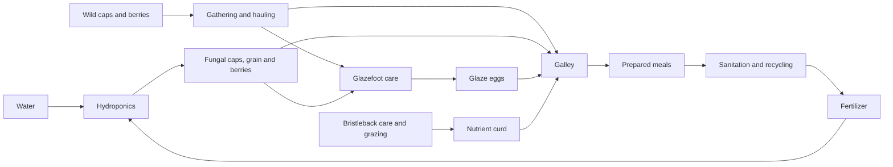

# Flora, livestock and cooking

Status: implemented in the local hex build, verified by focused checks, a fresh-colony gathering/cooking trial and a complete supplied farming/livestock trial. The published v0.1.2 game does not include this expansion.

## A connected food chain

Hydroponics grows distinct crops. Handlers can feed fungal caps to glazefoots and collect eggs; bristlebacks provide nutrient curd. Cooks combine the actual harvested ingredients into meals. Haulers move those ingredients through the same finite inventories as other supplies.

This is a gameplay nutrient loop, not a closed biological mass model: animal output and grazing retain the existing abstract husbandry rules. Production, hauling, cooking, waste and stored quantities remain explicit.

## Crops

Each crop produces two food units. Water and fertilizer must be physically delivered; crops need power, breathable air and suitable temperature.

| Crop | Water | Fertilizer | Temperature | Minimum Production skill |
| --- | ---: | ---: | --- | ---: |
| Fungal caps | 1 | 0.25 | 10–35 °C | 0 |
| Siltgrain | 1 | 0.25 | 10–32 °C | 0 |
| Sunberries | 1.5 | 0.25 | 15–30 °C | 3 |

Choose a crop in the hydroponics inspector. Its identity remains attached to harvested portions while they are carried, stored, reserved or processed. Historical generic food remains ordinary rations; it is never silently converted into a named crop.

## Native plants and gathering — local development

Wild plants now have persistent biomass and visible bare, sparse, growing, budding and mature stages. New colonies contain three wild fungal-cap patches and three sunberry patches, beginning at different stages. Plant placement is deterministic and does not alter the simulation's random sequence. Lichen remains the natural grazing food for bristlebacks.

| Native plant | Growth conditions | Natural regrowth | Mature harvest |
| --- | --- | --- | --- |
| Ground lichen | Ground, −40 to 35 °C | 2 biomass per 60 eligible ticks | Grazed by bristlebacks; not crew food |
| Wild fungalcap | Ground, −40 to 20 °C | 1 biomass per 30 eligible ticks | 2 fungal caps after 10 Production work |
| Wild sunberry | Ground, daylight, 0 to 30 °C | 1 biomass per 30 eligible ticks | 2 sunberries after 12 Production work |

Inspect a mature edible patch and choose **Gather**. A Production worker must physically reach it and finish the work. The plant then falls from 100 to 20 biomass, and two typed food units appear on that tile for haulers. Fungal caps can feed glazefoots or enter recipes; berries combine with bristleback curd. Cancelling or interrupting a gathering order grants no food. A completed harvest cannot be repeated until the patch matures again.

Cold or darkness pauses growth where the species requires it. Fire and construction that covers the ground remove affected plants. Fences and gates preserve patches; husbandry posts preserve lichen. Grazing nutrition is proportional to the biomass actually eaten. Native biological growth is currently an abstract environmental source: it does not draw stored colony water or air. Soil moisture, spreading, seeds, orchards and full biomes remain future work.

Schema 42 migrates existing schema-40/41 hex colonies by preserving their exact lichen quantities in plant records. It creates no edible patches or food in those older colonies. Covered legacy lichen survives a no-step reload, then is removed during the first normal ecology update. Focused checks, a fresh-colony gathering/cooking trial and browser review passed; see the verification index for scope and evidence.

## Animals

| Species | Food source | Product | Distinct behavior |
| --- | --- | --- | --- |
| Bristleback | Existing colony food and natural lichen grazing | Nutrient curd | Six-legged native grazer with mineral plates |
| Glazefoot | Delivered raw fungal caps | Glaze eggs | Four-footed grazer with a translucent dorsal fan; depends on gathered or cultivated fungal feed |
| Tibble | Existing food stocks and crop biomass | None | A pest that can raid supplies and damage hydroponics |

Livestock require care and sufficient nutrition before producing. Young animals do not yield products. Breeding pairs must be unrelated adults of the same species; both livestock species share pasture space and enclosure limits. Fences, gates and physical handler transport remain part of the chain.

New colonies gain two wild adult glazefoots. Loading an older colony does not create animals or grant food. Broods and edible harvested eggs are separate gameplay states.

## Recipes and progression

Every recipe consumes two raw-food units and produces two prepared-food units. Water, work and actual ingredient identities differ.

| Recipe | Ingredients | Minimum Production skill |
| --- | --- | ---: |
| Basic ration | Any two unprepared food units | 0 |
| Grain flatbread | Two siltgrain | 0 |
| Fungal stew | Two fungal caps | 0 |
| Curd bake | One siltgrain and one curd | 3 |
| Berry curd | One sunberry and one curd | 3 |
| Glaze omelet | One glaze egg and one fungal cap | 3 |
| Colony feast | Half a unit each of grain, caps, curd and eggs | 6 |
| Starlight platter | Half a unit each of grain, berries, curd and eggs | 9 |

Farming and cooking currently use the existing **Production** skill. An operator must qualify for the selected recipe. Cooking quality has four levels, reached at skill 0, 3, 6 and 9. More elaborate dishes add a small comfort benefit when actually eaten; ingredients are never multiplied into extra servings.

The galley inspector shows the selected recipe, delivered and missing ingredients, skill requirements and any committed current batch. Changing the next recipe preserves paid work already underway. Prepared food cannot be cooked repeatedly as raw ingredients. Meals retain the oldest ingredient age; cooking does not restore freshness.

## Saves, controls and scope

The expansion uses schema 42 with migration from schema-40/41 hex saves. Existing food amounts, ages, prepared meals and committed batches are preserved by migration checks. Square saves retain their protected export behavior. Gathering and crop/recipe selection use shared player/agent actions. Plant stages, harvests, removals, ingredients, animal products and meals retain machine-readable labels. The interface stays in existing hidden inspectors.

Further ecology work includes soil moisture, plant spreading, seeds, orchards, full biomes and seasonal or orbital growing conditions, more species, distinct animal physiology, veterinary care, inherited traits, meat and fibre production, and additional preservation methods. Physical habitat decks remain a separate roadmap item.

## Verified fresh-colony gathering trial

Starting from an ordinary new colony, crew spent six alloy and one component to build a galley. They gathered two wild fungal caps, physically carried them inside and used 0.5 water to cook two quality-two fungal-stew portions. This finished at tick 66 using five shared commands. The original 24 rations were untouched; all seven crew and five animals remained healthy. Initial, partial-work, harvested and cooked checkpoints reopened byte-for-byte exactly.

This proves ordinary gathering and galley construction. It does not yet prove building and sustaining the entire farming/livestock chain from scratch.

## Verified supplied farming and livestock trial

One explicitly supplied habitat completed the sequence at tick 605 using 12 shared commands: two fungal-cap crops yielded four units, three care deliveries tamed a native glazefoot, natural product accumulation yielded two eggs, and the galley combined one cap with one egg and 0.25 water into two quality-two omelet units. A crew member ate 0.125; 1.875 prepared units and one spare egg remained. No ingredients, animal trust, product readiness or experience were granted. The setup provided buildings, wiring, finite charged batteries and ordinary finite supplies; it did not prove construction from a fresh colony.

All seven crew remained healthy, physical ledgers reconciled and ten checkpoints reloaded exactly. Browser checks cover crop selection during live updates, current/next batch preservation, eight recipe choices, skill and ingredient explanations, save/reload and a narrow inspector. See [verification status](verification-status.md) for test scope and retained limitations.
